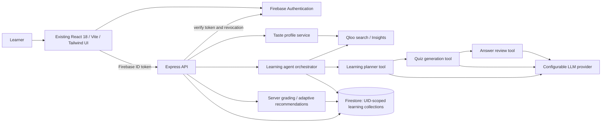

# LearnByQuiz — taste-aware learning

**Release status:** Firebase and all Qloo categories now pass live verification. The remaining full-workflow blocker is the configured LLM provider’s API credit balance. See [live Firebase results](docs/firebase-verification.json) and [production verification](docs/production-readiness.md).

LearnByQuiz extends the original React quiz application with Qloo cultural discovery and an AI learning workflow. Firebase email/password authentication, Open Trivia DB categories, timed classic quizzes, scoring, and answer summaries remain available. Open **AI Learning Journey** after signing in to use the new features.

The learner selects broad interests, actual Qloo entities, and educational subjects. Qloo supplies related cultural works and tags. AI tools turn that context into a learning plan and five educational questions, then independently review the proposed answers. The server grades completed quizzes and uses performance to recommend revision and adjust difficulty.

## Architecture and stack



React Router, Zustand, Framer Motion, and the existing visual conventions are retained. New server code uses Express, Firebase Admin, Zod, Helmet, and request rate limiting. Node's test runner, Supertest, and Playwright cover backend and browser behavior. Firebase, React Router, and Vite dependencies were updated for security; a gRPC override patches a vulnerable transitive SDK dependency. Use the committed lockfile.

## Local development

Prerequisites: **Node 22.18+**, npm, a Firebase project with Email/Password sign-in enabled and a Firestore Native database, Qloo access, and a function-calling LLM account.

```sh
npm ci
cp .env.example .env
# Fill in the values described below.
npm run migrate
npm run dev
```

Vite serves the browser at `http://localhost:5173`; `/api` proxies to the Node backend on port 3001. `npm run dev:client` and `npm run dev:server` can run independently. `npm run preview` previews the static build only; use the backend for learning APIs.

| Configuration | Purpose |
| --- | --- |
| `VITE_API_KEY`, `VITE_AUTH_DOMAIN`, `VITE_PROJECT_ID`, `VITE_APP_ID` | Existing Firebase web configuration, supplied at frontend build time |
| `VITE_STORAGE_BUCKET`, `VITE_MESSAGING_SENDER_ID` | Remaining Firebase web configuration |
| `FIREBASE_PROJECT_ID` | Same Firebase project used by the client |
| `GOOGLE_APPLICATION_CREDENTIALS` | Path to an Admin service-account file **outside the repository**; omit when using application default credentials/workload identity |
| `QLOO_API_KEY` | Backend-only Qloo key |
| `QLOO_BASE_URL` | Defaults to `https://hackathon.api.qloo.com`, which is required for hackathon keys; override only when using a separate production key |
| `LLM_API_KEY` | Backend-only provider key |
| `LLM_BASE_URL` | HTTPS OpenAI-compatible API base; defaults to `https://api.openai.com/v1` |
| `LLM_MODEL` | An available model supporting Chat Completions function calling; explicitly required |
| `GOOGLE_CLOUD_QUOTA_PROJECT` | Optional Google quota target; cross-project accounts require Service Usage Consumer access there |
| `PORT` | Backend port, default 3001; update the Vite proxy if changed |

Never give a provider key a `VITE_` prefix. Firebase web config identifies the public project; provider and Admin credentials stay server-side. Grant the backend only the Firebase Auth lookup and Firestore access it needs. Enable your local and production domains in Firebase Authentication.

Provider credentials belong only in the ignored `.env` file or a deployment secret manager. The committed `.env.example` must contain blanks. Missing provider configuration produces an explicit service-unavailable message. There are no production mock responses or fake execution traces.

## Qloo integration

`server/services/qloo.js` provides `searchEntities`, `discoverTaste`, `getRelatedEntities`, and `getPersonalizedRecommendations`. The latter three use the documented Insights API rather than invented relationship endpoints.

| Operation | Official contract used |
| --- | --- |
| Entity lookup | `GET /search?query=...&types=urn:entity:movie&take=10`; `results` contains the entity array; search tags use `tag_id`, normalized to `id` |
| Related cultural recommendations | `GET /v2/insights?filter.type=urn:entity:book&signal.interests.entities=<comma-separated UUIDs>&filter.exclude.entities=<seed UUIDs>&take=10`; entities are under `results.entities` |
| Authentication | `X-Api-Key` request header |

Supported search/output categories are movies, television, artists, books, games, destinations, places, brands, people, and podcasts. Broad interests such as technology and sports are learner inputs, rather than invented Qloo entity categories. Search real titles, brands, or people to resolve cultural references. Tags come from returned entity metadata; no demographic endpoints are called. The API re-resolves profile selections through Qloo before saving and discards client-supplied cultural metadata.

Search tags with `tag_id` and Insights tags with `id` normalize to the same internal schema. Place `tags: null` becomes an empty list; artist namespace placeholders without a tag ID/name are excluded without inventing metadata. Successful normalized responses are cached for five minutes in a bounded in-process cache. Responses are schema-validated. A 404 search response becomes an empty result; malformed responses, authentication failures, timeouts, and rate limits produce explicit errors. Provider error bodies and keys are not returned to clients. Rate-limited calls require a later manual retry, avoiding automatic retry storms.

The integration was rechecked against the [Qloo Agentic Hackathon Developer Guide](https://docs.qloo.com/reference/qloo-llm-hackathon-developer-guide). Hackathon requests use GET and the `X-Api-Key` header on `hackathon.api.qloo.com`. They do not use legacy `/recs` or `/recommendations` routes. Note a documentation discrepancy: the guide lists `urn:entity:video_game`, but its linked API schema and live hackathon requests accept `urn:entity:videogame`; `video_game` returned HTTP 400. The project retains the live-verified spelling. Search and Insights have distinct tag formats, normalized at the service boundary. See the [verification record](docs/qloo-verification.md).

Contracts were also checked against [Qloo's official documentation repository](https://github.com/qloo/docs-public), including [search](https://github.com/qloo/docs-public/blob/main/reference/get-search.md), [authentication](https://github.com/qloo/docs-public/blob/main/reference/api-onboarding.md), and [Insights parameters](https://github.com/qloo/docs-public/blob/main/reference/insights-api-deep-dive.md). The LLM adapter follows [OpenAI's Chat Completions function-calling contract](https://developers.openai.com/api/reference/resources/chat/subresources/completions/methods/create).

## Agent workflow and educational validation

Only executed steps appear in the stored trace:

1. Read the saved learner profile.
2. Call Qloo with actual seed entity IDs. Empty discoveries stop generation.
3. Analyze recent results and call `create_learning_plan` with structured arguments.
4. Call `generate_quiz` for exactly five questions in the chosen format.
5. Call `review_quiz` to independently solve questions and review explanations. Rejected or uncertain drafts are not stored as quizzes.
6. Persist the validated activity and completed execution trace.

The plan must use a selected educational subject. Quiz schemas reject duplicate questions, duplicate options, invalid answer indexes, incorrect option counts, malformed true/false answers, and mismatched difficulty/format. True/false uses two options; multiple choice uses four. Context is treated as untrusted data. Execution steps record actual status, start time, duration, and failures; the UI polls persisted traces while generation runs.

Generation is a bounded, server-orchestrated workflow with forced structured function calls, rather than an autonomous open-ended chatbot. AI review reduces errors but **cannot guarantee factual correctness**; no source retrieval or external fact checker is implemented. Qloo supplies cultural relationships, not educational truth. The UI labels Qloo discoveries separately from AI educational content and performance-engine recommendations.

## Storage and migrations

No existing database models were present. `npm run migrate` applies the idempotent additive `001_taste_learning` migration marker. Firestore creates the following document collections on first write:

```text
learningUsers/{verifiedFirebaseUid}/
  profiles/taste        selected interests, canonical Qloo entities, subjects
  plans/{uuid}          AI learning plan and Qloo discovery snapshot
  quizzes/{uuid}        saved questions and server-only answer keys
  performances/{quiz}   one graded result per saved quiz
  executions/{uuid}    actual workflow steps, timing, errors
learningMigrations/001_taste_learning
```

Taste entities and recommendation context are embedded in profiles/plans; adaptive recommendations are derived from performance rather than stored as duplicate records. All list queries use a single `createdAt` order and need no composite index. Profile IDs and performance IDs avoid duplicate records. Concurrent grading uses a Firestore transaction and is idempotent. Quiz answers and explanations are withheld until submission; the backend grades against the stored quiz. Quiz start time and elapsed wall-clock duration are server-maintained.

Merge `firestore.rules` into any existing rule set before deploying it. It denies direct browser access to the new collections; only the authenticated backend uses Admin access. Existing broad allow rules must not override these restrictions, because Firestore matching allows are additive. Do not replace unrelated existing rules. Migration does not rewrite Firebase users or the original browser `question-storage` data. Users can edit or delete their preference profile; deleting it retains saved activities and results, as stated in the interface. Historical plans retain their cultural context.

## Adaptive learning and analytics

The dashboard analyzes the latest **100 submitted personalized quizzes**. It tracks correct/incorrect answers, accuracy, server elapsed time, topic and difficulty performance, and recent progress. Topics below 60% accuracy become revision priorities. The latest quiz's accuracy moves difficulty down below 60%, holds it from 60–79%, and increases it at 80% or above, bounded by easy/hard. After the first completed quiz this performance rule overrides the starting difficulty selector. Taste provides contextual examples and never changes grades or the adaptive rule. Classic Open Trivia DB attempts remain browser-local and are not included in the new analytics.

## API

All routes below require `Authorization: Bearer <Firebase ID token>`. Identity comes only from verified tokens; request bodies cannot select another UID. `/api/health` is public. Responses use JSON; errors are `{ "error": { "code", "message", "requestId" } }`.

| Method / route | Request or result |
| --- | --- |
| `POST /api/taste/discover` | `{query, type?}` → Qloo entities |
| `GET /api/taste/profile` | Current profile or null |
| `PUT /api/taste/profile` | `{interests: string[], subjects: string[], entities: QlooEntity[]}`; at least one subject and entity |
| `DELETE /api/taste/profile` | Delete preference profile; 204 |
| `GET /api/taste/recommendations?type=book` | Qloo recommendations from the saved profile |
| `POST /api/agents/learning-plan` | `{difficulty?, format?, targetType?}` → saved plan and trace |
| `POST /api/agents/generate-quiz` | Same input → saved quiz, plan, trace; quiz answer keys redacted |
| `GET /api/agents/executions` | Latest 10 user-owned traces |
| `POST /api/learning/quizzes/:id/start` | Start/resume saved quiz; return quiz and any existing submitted review |
| `POST /api/agents/analyze-performance` | `{quizId, answers: [0,1,2,3,0]}` → graded result, analytics, recommendations |
| `GET /api/learning/dashboard` | Profile, analytics, recommendations, latest 20 quizzes, 10 plans, 10 executions |

Difficulty: `easy`, `medium` (Intermediate in the UI), or `hard`. Format: `multiple` or `boolean`. Defaults: medium, multiple, book. `QlooEntity` includes `entity_id`, `name`, `subtype`, `tags`, and nullable `affinity`. Saving uses the selected ID/name to retrieve canonical metadata from Qloo.

Requests are limited to 100 per minute per IP. Plan/quiz requests share a limit of 10 per hour per UID; one generation per user runs at a time per process. Logs include request ID, method, path and response status, with no tokens, preferences, or provider secrets. Inputs are bounded and validated. The server adds security headers and a CSP.

## Testing

```sh
npm test                    # Unit and HTTP integration tests; no credentials
npm run build               # Production frontend build
npm run test:browser         # Desktop + mobile browser workflows; external requests mocked
npm run test:live            # Real Qloo search + Insights; skips without QLOO_API_KEY
npm run test:firestore       # Actual adapter and rules tests; requires emulator
npm run test:emulator        # Start the official demo emulator and run those tests
npm run verify:live          # Strict live Firebase/Qloo/LLM prerequisites; never skips
npm run test:live:qloo       # Every application Qloo category
npm run test:live:firebase   # Actual Auth, Firestore, deployed rules and transaction checks
npm run test:live:all        # Release gates and full cloud workflow when prerequisites pass
npm audit
```

For browser tests, install Chromium if needed with `npx playwright install chromium`. Playwright starts a separate Vite server with synthetic Firebase configuration. It mocks Firebase responses, Qloo/API responses, and trivia only inside the tests. These tests verify UI wiring rather than real provider access.

For Firestore integration, start a Firestore emulator on port 8080 using Firebase CLI, then run:

```sh
FIRESTORE_EMULATOR_HOST=127.0.0.1:8080 npm run test:firestore
```

The integration test requires the emulator variable, uses `demo-learnbyquiz`, and cleans up its own generated user documents. It never falls back to production. The Qloo live test uses `.env` credentials and makes real provider calls; skipped tests do not count as verified live integration. LLM tests verify tool-call payloads and output validation with mocked providers. A live full-stack demo additionally requires working Firebase/Admin and LLM configuration.

## Production deployment

1. Use a Node 22.18+ host with HTTPS and Firestore access. Add the production origin to Firebase Auth authorized domains.
2. Supply Firebase `VITE_*` values **at build time**, then run `npm ci && npm run build`.
3. Configure backend environment variables and workload identity/ADC through the host's secret manager. Do not put provider secrets into Docker build arguments.
4. Merge and deploy the new Firestore access rules, then run `npm run migrate` against the intended project.
5. Run `npm start`. Express serves `dist`, the SPA fallback, and `/api` on one origin.
6. Set ingress/proxy timeouts to at least 240 seconds for the bounded three-call AI workflow. Preserve authentication headers.

A multi-stage `Dockerfile` is included. Pass only public Firebase values as build arguments. The runtime runs as a non-root user. Mount credentials outside the image or use workload identity. Deploy one API process initially: caches, rate-limit stores, and generation locks are process-local. Before horizontal scaling, use a shared rate-limit/lock store. If a trusted reverse proxy is used, configure Express `trust proxy` for the exact proxy topology before relying on per-client IP limits; it is deliberately not enabled blindly.

## Demo workflow

1. Register or sign in to the configured Firebase project.
2. Open **AI Learning Journey** and select Science fiction, Technology, and Space exploration.
3. Search Movies for **Interstellar** and add the actual result returned by Qloo. Select **Astronomy** and save preferences.
4. Select Books (or another category) and choose **Discover related interests**. Show the real Qloo names/tags and affinity when returned.
5. Generate a personalized quiz. Show the actual execution trace and the saved plan's explanation of how culture maps to learning.
6. Start the saved astronomy quiz, answer all five questions, and submit.
7. Show explanations, accuracy, elapsed time, subject performance, and the recommended next difficulty/revision activity.
8. Generate another quiz to show that demonstrated performance guides the next activity.

UI screenshots captured by the browser tests are available for [desktop](docs/screenshots/journey-desktop.png) and [mobile](docs/screenshots/journey-mobile.png). These use test fixtures and are not evidence of live Qloo or Firebase access. Capture a configured live demo and add its video link before submission; no live video is included.

## Known limits and verification

- Qloo authentication, search, tag normalization, and book/gaming Insights were verified against the live hackathon API on October 31, 2026. LLM, Firebase authentication, and deployed Firestore access still require separate configuration and live verification.
- AI answer review uses a separate call to the configured provider; no independent factual source verification is available.
- Generation is synchronous and bounded. A process crash may leave a running trace; execution jobs are not automatically resumed. Use a durable job queue before deploying across workers or supporting long-running activities.
- Analytics are a rolling window; difficulty thresholds are a transparent initial policy, not a validated educational assessment model.
- Quiz retries return the original result. Generate a new quiz for another graded attempt. Elapsed time includes time away after starting a quiz.
- Deleting a taste profile removes current preferences; historical plans/quizzes remain. An account-wide historical-data deletion/export workflow is not included.
- This change prepares local source and deployment configuration. It does not create cloud resources, publish a website, or claim a completed hackathon submission.

See [implementation notes](docs/implementation.md) for the plan review, phase map, and validation record.
